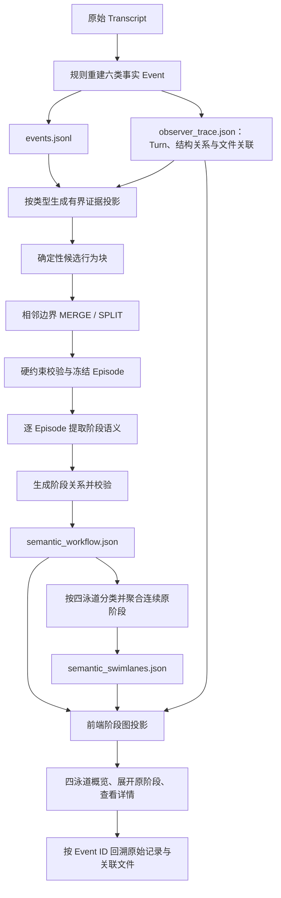

# 阶段级概览工作流可视化：设计、数据来源、关系语义与实现说明

> 文档用途：毕业论文撰写参考，重点对应“阶段级工作流重建与可视化”小节。
>
> 整理日期：2026-11-08。
>
> 核对版本：`2cba73945e63a035a4208a5acb3a47aa6d3baf50`，分支 `agentvast-9-15-latest`。
>
> 适用界面：顶部第三个入口“工作流可视化”，当前实现为“四泳道语义工作流”。
>
> 依据：当前后端、前端、数据类型和已有测试代码；文中的教学示例使用虚构标识与内容，不是实际会话记录。本文未重新调用语义模型，未修改应用代码。

## 1. 这张图解决什么问题

数据分析 Agent 完成任务时，运行记录中同时包含用户要求、模型可见响应、工具调用、命令执行、子任务结果与流程变化。直接展示这些记录，能够保留执行细节，却难以让用户迅速理解整个任务是如何推进的：先理解了什么输入，选择了什么方法，进行了哪些分析，又在哪里调整了既有方案。

阶段级概览图的设计目标，是将连续的执行行为组织为有明确子目标的分析阶段，再按活动性质归入“输入、规划、执行、修改”四条纵向泳道。用户首先阅读较少的语义块，理解任务主线；需要核实时，再展开原阶段、查看动作与结果，并跳转到原始执行证据。

因此，这张图承担三个层次的阅读任务：

1. **概览任务过程**：识别任务经历了哪些主要子目标，哪些活动属于输入理解、方法规划、实际执行或修改纠偏。
2. **理解阶段联系**：区分记录顺序与验证、修订、重试、结果引用等语义联系。
3. **回溯执行依据**：从聚合块返回原阶段，再通过 Event ID 找到支持描述的执行记录与关联文件。

设计强调“减少首次阅读量，同时保留回溯路径”。它不是把整个会话概括成四个节点，也不是要求 Agent 按四步固定执行。每条泳道可以有多个块，也可以为空；任务可以反复在不同活动类型之间切换。

### 1.1 与事件级详细工作流的分工

| 对比项 | 阶段级概览工作流 | 事件级详细执行工作流 |
| --- | --- | --- |
| 核心问题 | 整个任务经历了哪些分析阶段，如何推进和调整 | 某次具体行为做了什么，与哪些行为有关 |
| 节点基本单位 | 原语义阶段，概览时可进一步聚合为语义块 | 六类运行 Event |
| 横向组织 | 输入、规划、执行、修改四类活动 | 各 Turn 横向并列的详细布局 |
| 语义输入 | 事实 Event 的证据投影及阶段上下文 | 逐批生成的 Event 行为摘要等 |
| 关系类型 | `NEXT` 加四类阶段语义引用关系 | 另有固定的 13 类 Event 逻辑关系与事实结构关系 |
| 重点信息 | 子目标、阶段摘要、结果、异常与宏观衔接 | 行为摘要、行为角色、具体输入输出、Event 间关系 |

**两者共享事实 Event，但属于两条不同的语义处理与展示链路。** 不能将事件级的 13 类关系、四类行为角色评级，直接写成这张四泳道概览图已经采用的视觉编码。

## 2. 系统中的几个“块”分别是什么

“事件、候选块、阶段、聚合块、前端节点”在实现中不是同一个对象。论文中建议先明确这些概念，再讨论图的节点。

| 名称 | 对应对象 | 形成方式 | 作用 |
| --- | --- | --- | --- |
| 运行事件 Event | `events.jsonl` 中的一个 Event | 规则重建 Transcript 中的完整行为及来源 | 事实基础与证据最小引用单位 |
| 候选行为块 Candidate Block | `candidate_blocks.json` 中的一个候选 | 按响应归属、工具批次、生命周期与恢复等规则初步聚合 | 给阶段边界判断提供有序候选 |
| 冻结阶段 Episode | `episodes` 中的一个对象 | 相邻候选的 MERGE/SPLIT 判断，加本地硬约束 | 固定阶段范围，约束后续解释 |
| 原语义阶段 Semantic Node | `semantic_nodes` 中的一个对象 | 对一个冻结 Episode 提取目标、行为与已记录结果 | 原阶段级工作流的语义节点 |
| 概览语义块 Group | `semantic_swimlanes.groups` 中的一个对象 | 同一目标下对连续原阶段进一步分类与聚合 | 四泳道默认显示的概览卡片 |
| 前端显示单元 Unit | `projectSemanticSwimlanes()` 的投影结果 | 根据折叠状态映射 Group 和原阶段 | 决定当前画布上的卡片、坐标和关系端点 |

正常模型生成路径采用“一个冻结 Episode 对应一个原 Semantic Node”。后端人工复核支持合并、拆分等操作，因此人工校正后的历史视图可以有例外；不能将自动生成约束表述为所有版本永不变化的事实。

默认折叠时，图中的一个业务节点是 **Group**。Group 可以只包含一个原阶段，也可以包含多个连续原阶段。展开多阶段 Group 后，聚合概览卡片仍保留，下面显示其原阶段卡片；具体关系的端点切换到相应原阶段。

泳道标题和浅色背景也以 React Flow 节点实现，但它们是界面装饰和分类容器，不是分析行为节点。

## 3. 总体设计思路与数据流

系统采用“事实记录—受约束阶段重建—语义概览聚合—交互式证据回溯”的组织方式。前两次聚合解决不同问题：

- 第一次，从 Event 组织出有行为边界的阶段，回答“哪些行为属于一次阶段性活动”。
- 第二次，在已有阶段上压缩共同子目标，回答“概览图中哪些连续阶段可以作为一个语义块阅读”。



上图是**处理流程示意**，不是实际阶段图的关系方向定义。实际图中存在指向早期阶段的语义引用，详见第 8 节。

### 3.1 事实与解释分离

事实 Event 保存可观察的行为、请求、结果、状态与来源。模型生成的阶段目标、摘要、关系与聚合解释另存为语义产物，不覆盖事实文件。

这种分离使同一份执行记录可以在不同模型、提示要求或人工复核版本下重新解释；用户对语义解释的校正，也不需要改写原始日志。

### 3.2 先确定边界，再解释阶段

系统先冻结 Episode，再要求模型对当前 Episode 生成且只生成一个 Semantic Node。模型可以调整表达详略，但不能在摘要阶段任意把两个阶段重新合并、拆分或重排。

这样可以将“阶段划分是否合理”和“阶段描述是否准确”分开检查，避免模型一边解释、一边随意改变分析单元。

### 3.3 先建立阶段图，再做概览聚合

四泳道模型消费已有阶段及其关系，不重新阅读全部 Transcript，也不重新切分 Event。它只决定阶段归属哪个泳道，以及哪些连续阶段可以作为共同子目标聚合。聚合模型不负责新增阶段关系。

## 4. 数据来源与中间产物

以下路径均以一个观察会话的目录为根。默认位于 `~/.agentvast/observations/<session-id>/`，可通过配置使用其他观察根目录。

### 4.1 原始证据与事实输入

| 文件或对象 | 内容 | 在本模块中的用途 |
| --- | --- | --- |
| `transcript/transcript.jsonl` | 原始执行记录快照 | 最终可回溯的底层证据，不直接作为四泳道模型输入 |
| `raw/transcript.jsonl` | 含原始行、解析记录与行号的封装记录 | 上游规则重建 Event 的输入 |
| `derived/events.jsonl` | 六类事实 Event，含行为内容与来源引用 | **阶段语义分析的标准事实输入** |
| `derived/observer_trace.json` | 会话、Turn、结构关系、文件、统计、诊断与 Event 视图 | 提供上下文、候选聚合依据、前端动作计数和文件映射 |
| 当前 Turn 的用户请求 | 用户目标与约束 | Episode 标注的任务上下文 |
| 邻近 Episode 的可观察主题 | 前后活动的简短主题 | 辅助消歧，不替代当前阶段的证据 |

`_load_semantic_event_source()` 优先读取 `events.jsonl` 中的 Event，并使用展开适配器恢复统一内存表示；`observer_trace.json` 提供其他上下文。对 `observer-trace/2.0` 会话，缺失或空的 Event 文件会触发错误，不静默退回不完整记录。旧版会话有只读兼容路径。

Hook、OTel 等是观察系统的其他记录通道，但本图的直接语义输入不是将 Hook、OTel、Transcript 原文拼接后交给模型。应在论文中画出“上游采集”和“阶段重建直接输入”的边界。

六类事实 Event 为：

| Event 类型 | 提供的主要信息 |
| --- | --- |
| `user_prompt` | 用户目标、要求、反馈与约束 |
| `model_response` | 模型可见响应、阶段说明与已报告结果 |
| `tool_execution` | 工具名称、输入、返回、状态与配对来源 |
| `command_execution` | 命令、工作目录、返回及明确记录的执行字段 |
| `subagent_result` | 被委派任务的摘要与子 Agent 已报告结果 |
| `control_event` | 中断、恢复、上下文压缩等可观察流程变化 |

### 4.2 阶段重建产物

| 路径 | 主要内容 |
| --- | --- |
| `derived/semantic_stages/<inference-id>/key_information_events.json` | 供语义分析使用的按类型证据投影 |
| 同目录 `candidate_blocks.json` | 初始候选行为块及其来源 Event |
| 同目录 `boundary_request.json` | 边界判断请求及提示词 |
| 同目录 `validated_boundaries.json` | 模型判断、最终生效判断及硬约束覆盖原因 |
| 同目录 `episodes.json` | 冻结后的阶段范围 |
| 同目录 `annotations/` | 各阶段请求、模型返回、局部校验和节点结果 |
| 同目录 `semantic_nodes.json` | 原阶段语义节点集合 |
| 同目录 `relation_request.json`、`relation_raw_response.json` | 阶段关系提取请求与模型返回 |
| 同目录 `relation_validation.json`、`relations.json` | 关系局部校验与组装结果 |
| 同目录 `validation_report.json` | 工作流证据及粒度校验报告 |
| `derived/semantic_workflow.json` | 当前原始阶段推断结果 |
| `derived/semantic_workflows/semantic-XXXX.json` | 阶段推断历史版本 |

`semantic_workflow.json` 的主要组成是：`source_events`、`source_trace`、`inference_run`、`boundary_decisions`、`episodes`、`semantic_nodes`、`relations`、`validation` 和 `review`。

来源对象保存路径和 SHA-256；推断对象保存模型、思考强度、处理版本、提示版本、时间、阶段数、性能指标和警告。这些元数据用于说明结果基于哪一份记录、哪一次解释生成。

### 4.3 人工复核与四泳道产物

| 路径 | 主要内容 |
| --- | --- |
| `derived/semantic_reviews.jsonl` | 追加式人工确认、更新、合并与拆分记录 |
| `derived/semantic_workflow_reviewed.json` | 重放当前推断对应的人工复核后视图 |
| `derived/semantic_swimlanes.json` | 当前四泳道聚合结果 |
| `derived/semantic_swimlanes/` | 被替换的历史聚合结果 |
| `derived/semantic_swimlane_stages/<fingerprint>/request.json` | 聚合提示词与 JSON Schema |
| 同目录 `raw.json`、可选 `raw-repair.json`、`output.json` | 原始模型输出、结构修复输出和通过校验的输出 |
| 同目录 `state.json` | 任务状态、错误、耗时与调用次数 |

`load_semantic_workflow()` 默认优先加载与当前 `inference_id` 匹配的复核视图，四泳道聚合也使用这一有效阶段视图。新一轮阶段推断不会直接继承不匹配的旧复核结果。

## 5. 阶段是怎样重建出来的

### 5.1 按 Event 类型形成有界证据

`build_key_information_events()` 为六类 Event 生成适合语义分析的投影，保留 Event ID、类型、状态、主体、作用域、时间、来源，以及与该类型有关的内容。

工具事件保留名称、输入、输出和结构化返回；命令事件区分命令、普通返回、明确的 stdout/stderr 和退出信息；子 Agent 结果保留任务与报告；流程事件保留可观察变化。冲突标记及差异记录进入证据包，不能将代表记录当成唯一事实。

长文本按预算形成有界摘要，保留截断标记、原始长度和哈希。原始 Event 与 Transcript 不因模型预算而被删除。纯工具调用包装的 `model_response` 不重复作为独立语义事实输入，但其调用归属仍可用于建立候选块，原事实记录仍保留。

这里的“关键证据信息”是类型化投影与去除重复包装，**不是先用 Event 重要性模型筛选一批高分事件**。

### 5.2 规则产生候选行为块

候选块以可观察的执行结构为基础：

1. 在每个 Turn 中，按顺序读取模型响应；通过事实层 `invokes` 关系，把一次响应及其调用的工具或命令组织到同一初始候选。
2. 终结响应识别为独立的终结候选；进度响应、生命周期调用和实际执行候选分别标注。
3. 子 Agent 结果作为具有独立任务标识的锚点保留。
4. 连续生命周期活动可进行确定性收束，避免任务状态维护占据过多阶段。
5. 满足规则的“相同工具与目标，前次失败、随后成功”相邻组合，可合为恢复候选。
6. 不在上述结构中的可见工作流 Event 补为独立候选，包括未关联执行、流程变化、独立请求或响应，避免因为缺少响应外壳而消失。
7. 用户请求作为所属任务的边界和上下文，通常纳入该 Turn 第一个候选。

这一步没有假定每次工具调用都是一个分析阶段，也没有要求每个阶段必须包含工具。

### 5.3 模型只判断相邻候选边界

边界模型收到有序候选集合，只能逐对判断相邻候选应合并还是分开，返回：

`left_candidate_id`、`right_candidate_id`、`decision`、`same_intent`、`reason`、`evidence_event_ids`、`confidence_level`。

其中 `decision` 只能为 `MERGE` 或 `SPLIT`；合并要求服务同一可观察意图。不能创建候选、删掉候选、跳跃合并或重排候选。不确定时优先拆分。

### 5.4 本地硬约束形成冻结 Episode

最终边界不直接照单全收模型结果。当前 `_effective_boundaries()` 执行以下约束：

| 情况 | 最终处理 |
| --- | --- |
| 相邻候选属于不同 Turn | 强制拆分 |
| 任一侧为终结响应候选 | 强制拆分，终结响应保持独立 |
| 当前 Episode 已有三个候选 | 继续相邻合并被阻止 |
| 合并后会包含多个子 Agent 结果锚点 | 强制拆分 |
| 模型结果缺失、无效或进入保守回退 | 按拆分处理 |

边界产物同时记录 `model_decision` 与 `effective_decision`，以及 `decision_origin`、`override_reason`。详情可以展示模型原判断与代码最终采用的判断。

“最多三个”限制的是**合并后的候选块数量**，不是三个 Event；一个候选可以包含多个 Event。该限制也不等于后续四泳道 Group 最多只能包含三个原阶段，后者没有相同的固定上限。

### 5.5 一个 Episode 生成一个阶段语义节点

每个 Episode 的标注请求包含三类上下文：

- `task_context`：当前 Turn 的原始请求摘要、会话和任务统计等。
- `episode_evidence`：当前阶段按六类 Event 分组的证据、允许引用的 Event ID、候选类型、锚点与边界信息。
- `neighbor_context`：前后 Episode 的简短可观察主题。

模型输出标题、主要活动、活动标签、目标、行为摘要、结果主张、模型置信度、不确定原因与是否弃答。所有语义证据引用必须来自当前 Episode，不能把相邻阶段的成功结果写到当前阶段。

目标、摘要和结果的职责分开：

- **目标 objective**：这一阶段试图完成什么。
- **摘要 summary**：记录表明 Agent 实际做了哪些主要行为。
- **结果 outcome_claims**：模型、工具或子 Agent 已经报告了什么结果及限制。

“已报告”不等于系统对结论事实正确性的独立背书。缺少证据时可以使用 `Uncertain`、低置信度与弃答标记。

原阶段标注默认采用四路并发，可配置为 1–8 路；结果仍按冻结阶段顺序组装。边界、标注、关系与校验之间保持依赖顺序。页面中的“阶段摘要要求”只调整文字详略，不改变 Episode 边界。

## 6. 原阶段语义与四泳道分类不是同一套标签

原阶段 `primary_activity` 的当前模型枚举为：

`Task Understanding`、`Data Understanding`、`Data Preparation`、`Exploration`、`Analysis`、`Visualization`、`Validation`、`Refinement`、`Synthesis`、`Communication`、`Uncertain`。

它描述阶段的主要活动。四泳道另使用 `input`、`planning`、`execution`、`revision` 分类，是面向概览阅读的第二套组织方式。

尤其需要注意：原阶段当前模型枚举**没有单独的 Planning 类**。四泳道的“规划”来自对已有标题、目标、摘要、标签和上下文的再理解，而不是要求原阶段必须先被标成 Planning。前端保守回退兼容 Planning 等历史值，也可依据明确的规划标题归类，但这不改变当前阶段标注 Schema。

## 7. 四泳道编码与语义聚合

### 7.1 横向位置与颜色编码

四列从左到右固定，横向位置表达活动类别，而不是参与者、线程、工具或时间单位。

| 列序 | 内部值 | 中文名称 | 语义范围 | 主色 | 背景色 |
| --- | --- | --- | --- | --- | --- |
| 1 | `input` | 输入 | 任务、约束、资源接收与理解，数据本身的认识与探索 | 蓝 `#2563eb` | `#eff6ff` |
| 2 | `planning` | 规划 | 明确记录的目标拆解、方法/指标/路径选择、执行安排与方案确认 | 紫 `#7c3aed` | `#f5f3ff` |
| 3 | `execution` | 执行 | 沿当前方案读取、清洗、计算、分析、绘图、验证、综合及交付 | 绿 `#047857` | `#ecfdf5` |
| 4 | `revision` | 修改 | 根据异常、新发现、验证或反馈，修正既有方法、代码、范围、流程或结论 | 棕橙 `#b45309` | `#fffbeb` |

卡片左侧强调边框、阶段编号色块与所属泳道主色一致；泳道背景使用对应浅色，降低大面积高饱和度背景对文本的干扰。泳道标题提供文字解释和语义块数量，使含义不只依赖颜色。

### 7.2 判别时容易混淆的情况

| 行为 | 当前设计的归类原则 |
| --- | --- |
| 查看数据字段、了解输入含义 | 可属于输入 |
| 基于数据计算统计量、进行具体分析 | 属于执行 |
| 明确决定采用何种分析方法或指标 | 属于规划 |
| 常规 TaskUpdate、状态反馈、工具外壳 | 不因形式看起来像安排就自动归规划 |
| 首次写代码、日常文件编辑 | 通常属于执行，不自动属于修改 |
| 因发现错误口径而改写已有计算方法 | 属于修改 |
| 修改后再次运行脚本 | 通常回到执行 |
| 对已有结果进行验证 | 通常属于执行；若验证导致纠偏，纠偏部分可属于修改 |
| 混合多种行为的原阶段 | 根据主要目标选一个泳道，并在归类理由中说明限制 |

这套编码按行为在任务中的作用分类，而不是按工具名称硬映射。它也不会把计划性语言当作已经执行的成果。

### 7.3 聚合模型具体读取什么

`run_swimlanes()` 构造一次全局输入，包含：

1. 四泳道定义与聚合规则 `RULES`。
2. 各原阶段的 Turn 归属 `stage_turn_ids`。
3. 原阶段关系 `relations`。
4. 按顺序排列的原阶段字段：`node_id`、`sequence`、`title`、`primary_activity`、`activity_tags`、`objective`、`summary`、`outcome_claims`、`errors`、`abstained`、`confidence`。

模型不直接消费原始 Transcript，不负责重做工具配对，也不以 `event_summaries` 作为这一层的主要输入。项目当前约定的语义模型为 `gpt-6.1-sol`、思考强度 `medium`，实际每次结果以 `inference_run` 中保存的配置为准；该配置与 Claude 交互终端使用的模型独立。

聚合通常一次模型请求；结构校验失败时最多追加一次结构修复请求。超出全量输入字符预算时明确停止，不通过静默删除阶段来凑输入。

### 7.4 哪些阶段允许聚合

允许合并的阶段必须满足设计上的共同条件：

- 同一 Turn 内；
- 在全局阶段序列中连续；
- 属于同一泳道；
- 共同服务一个明确的子目标；
- 不会将一条非 `NEXT` 阶段语义关系的两个端点隐藏在同一聚合块中。

不能因为都叫“执行”就把全部执行阶段合并，也不能把两个相隔很远但标题相似的阶段合成一个块。

后端可直接验证完整覆盖、顺序、Turn 边界、枚举和非 `NEXT` 端点保护；“是否确实同一子目标”“归类是否准确”仍主要依赖模型语义判断，需要人工或实验评估。结构合法不等于解释一定正确。

每个原阶段必须且只能归属一个 Group，按顺序展平 `node_ids` 后应与原阶段 ID 列表完全一致：

```text
concat(group_1.node_ids, group_2.node_ids, ..., group_m.node_ids)
    == 按 sequence 排列的全部原阶段 node_id
```

某泳道不存在对应活动时保持空列，不为视觉均衡虚构规划、修改或成果。

### 7.5 聚合对象包含什么

模型输出 `lane`、`node_ids`、`title`、`summary`、`reason`、`confidence`。代码添加稳定的 `group_id`、原阶段 Event ID 的有序去重并集和 `origin="inferred"`。

聚合标题表达共同子目标；摘要压缩共同目标、主要行为、关键结果与限制；理由解释为什么这样分类和合并。聚合解释本身属于新的模型解释，不自动继承原阶段的人工确认状态。

### 7.6 没有 AI 聚合结果时怎么显示

前端仍能显示已有原阶段，每个阶段形成一个单成员 Group，按活动和明确标题保守归类：Refinement 归修改；任务/数据理解及探索通常归输入；明确规划标题归规划；其余主要归执行。

此时页面标注“按现有阶段归类”，不宣称已经完成 AI 的共同目标聚合。只有用户触发“聚合语义”并得到有效结果后，才应用新的 Group 划分。

## 8. 节点之间的 relation 是什么、从哪里来

### 8.1 两类边的职责

阶段图同时保存：

- **记录顺序边** `NEXT`：由确定性代码连接相邻阶段，帮助用户阅读过程。
- **语义引用边**：模型根据已重建的阶段内容判断验证、修订、重试或结果使用的联系。

这些边均来自 `semantic_workflow.relations`。四泳道聚合不新建“因为在输入列所以指向规划列”等关系，泳道相邻和卡片同排也不构成业务联系。

### 8.2 当前关系表与箭头方向

| 类型 | 图中名称 | 当前方向 | 解释与成立依据 | 生成来源 |
| --- | --- | --- | --- | --- |
| `NEXT` | 记录顺序 | 较早阶段 → 相邻较晚阶段 | 原阶段序列中的相邻顺序；不证明因果或执行依赖 | 代码 `_relations()` 确定性生成 |
| `VALIDATES` | 验证 | 验证阶段 → 被验证阶段 | 后一阶段实际检查、对照或检验此前方法、产物或结果 | 模型关系提取；另有保守回退规则 |
| `REFINES` | 修订 | 修订阶段 → 被修订阶段 | 对此前方法、内容或结果作了有记录依据的修正或改进 | 模型关系提取 |
| `RETRY_OF` | 重试 | 重试阶段 → 先前失败阶段 | 在失败后对同一目标再次尝试 | 模型关系提取 |
| `USES_RESULT_FROM` | 引用结果 | 消费阶段 → 提供结果的阶段 | 当前阶段使用此前阶段已经产生或报告的结果 | 模型关系提取 |

论文可以据此解释各类型含义，但不要声称阶段模型已经接入 Event 层那套更详细的“13 类判断表、独立关系审查请求和 accepted/candidate/rejected 流程”。两条链路的约束强度不同。

### 8.3 NEXT 的生成依据

对于按顺序排列的原阶段 `N1, N2, ..., Nn`，代码逐对生成：

```text
N1 --NEXT--> N2 --NEXT--> ... --NEXT--> Nn
```

边的 `origin` 为 `derived`，`confidence_level` 为 `high`，证据取前一阶段末个 Event 与后一阶段首个 Event。这里的“高”表示顺序可确定，不表示两个阶段有强因果关系。

全会话阶段序列可能跨 Turn，`NEXT` 也可以跨 Turn；“禁止跨 Turn 合并”约束的是 Group 合并，不是禁止阶段图中出现跨 Turn 顺序边。

### 8.4 语义关系提取读取什么

`relation_prompt(nodes)` 为每个原阶段提供：

`node_id`、`sequence`、`title`、`primary_activity`、`objective`、`summary`、`outcome_claims`。

其任务是提取有 Evidence 支持的非时序关系。关系模型读取阶段摘要及其中的 Event 引用，而不是再次把全部原始工具输出加入关系请求。关系阶段通常在全部节点都由模型标注成功时调用。

当前提示明确规定：

```text
ValidationNode --VALIDATES--> EarlierNode
RefinedNode --REFINES--> EarlierNode
RetryNode --RETRY_OF--> FailedNode
ConsumerNode --USES_RESULT_FROM--> ProducerNode
不要输出 NEXT，NEXT 由确定性代码生成
```

返回对象为端点、类型、证据 Event ID 和置信度。代码再生成稳定关系 ID，并将模型关系标记为 `origin="inferred"`。

### 8.5 当前校验能保证什么

局部关系校验检查：Schema 版本、字段、端点存在且不同、类型在固定枚举内、不重复、证据 ID 非空且属于当前工作流、置信度枚举合法。

需要准确说明当前边界：

- 对关系方向的约束主要写在提示词中，当前阶段关系局部校验没有额外按 `sequence` 强制所有非时序边必须指向过去。
- 证据 ID 有效不等于证据文本充分支持该语义关系；阶段关系对象目前没有 Event 关系链路同样的逐字段原文 quote 审查。
- 当前阶段关系没有独立的模型复核请求，也没有完整图的无环性验证。
- 结构不合法时可以进行一次模型修复；修复仍失败则不接纳该批模型关系，并保留错误记录。

此外，`_relations(..., model_value=None)` 有一个启发式回退：若某阶段 `primary_activity == "Validation"`，就向前一阶段补一条 `VALIDATES`，标记 `origin="inferred"`、中置信度，并引用当前阶段 Event。因此“回退时一定只剩 NEXT”并不完全符合实际组装函数，论文应以代码为准。

### 8.6 为什么整张图不宜直接称为严格 DAG

单看 `NEXT`，节点序号递增，构成无环的顺序骨架。但是语义引用按“引用者 → 被引用者”保存，会指回早期阶段。例如：

```text
S1 --NEXT--> S2 --NEXT--> S3
S3 --VALIDATES--> S1
```

若将两类边放到一个图中，存在 `S1 → S2 → S3 → S1`，因此完整关系图可能有环。当前实现没有为了视觉上像 DAG 而反转语义引用箭头。

建议论文名称使用：**“具有顺序骨架和语义引用的阶段级有向工作流图”**，或 **“四泳道阶段级概览图”**。若论文确实需要严格 DAG，应另行定义所有边的统一前向依赖语义，并相应修改验证与展示；这是后续工作，不是当前已经实现的属性。

### 8.7 阶段关系如何投影到聚合图

折叠状态下，前端建立映射 `阶段 node_id → 所属 group_id`，再逐条投影原关系：

1. 查找原关系两个端点当前对应的显示节点。
2. 若两端映射到同一聚合块，折叠图中不画块内自连线；在合法自动聚合结果中，这类被隐藏关系应为块内 `NEXT`。
3. 若映射后端点不同，保留边的原方向和类型。
4. 相同显示起点、终点、类型的多条关系合并成一条显示边，保存全部 `relation_ids` 和证据 ID 的去重并集。
5. 展开 Group 时，端点重新映射到对应原阶段卡片，恢复精确端点和块内 `NEXT`。

合并显示边不等于产生更强证据。当前投影合并了 ID 与证据列表，但 `origin`、`confidence` 沿用先遇到的关系，并未重新计算一组关系的综合置信度。图中也没有通过线宽编码合并数量。

## 9. 整体页面由哪些区域组成

页面遵循“主画布优先，详情按需打开”的空间分配。

| 区域 | 显示内容 | 默认或交互方式 |
| --- | --- | --- |
| 顶部工具栏 | 语义块数、原阶段数、记录数；工具、命令、子任务统计；聚合与面板入口 | 紧凑横向排列，窄屏部分统计隐藏 |
| 聚合状态行 | 当前是保守归类还是 AI 聚合；顺序说明；模型、调用数、耗时及错误 | 独立的紧凑状态信息 |
| 主画布 | 四泳道背景、标题、卡片、箭头 | 占据剩余高度与宽度 |
| 画布导航条 | 定位当前、泳道总览、查看全图 | 控制视口，不改写图数据 |
| 左侧阶段目录 | 按全局顺序列出 Group，附泳道和原阶段数量 | 默认关闭，浮层打开 |
| 右侧阶段详情 | 聚合概览 / 原阶段两个页签 | 点击卡片或目录后打开 |
| 分析设置 | 阶段摘要要求、重新生成、继续未完成分析与运行指标 | 按需打开的右侧浮层 |
| 底部导航控件 | 缩放按钮、百分比、图例提示、MiniMap | 辅助长图定位与全局观察 |

目录和详情通过绝对定位叠加在画布两侧，避免常驻三列面板再次压缩四泳道空间。右侧详情在当前样式中宽度为 `min(360px, 100%)`；目录基本宽度 220px。两者默认均为关闭状态。

详情内部只有正文区域滚动，标题和页签保持紧凑。这样避免旧式“聚合说明一大块 + 阶段标题一大块 + 下面内容独立滚动”的重复占位。

## 10. 布局算法：四列固定，按序推进与回访换行

### 10.1 不使用随机力导向布局

卡片位置由 `projectSemanticSwimlanes()` 按原阶段顺序与泳道编号确定；不是按力导向算法随机排布，也不是按语义边计算完整图的拓扑排序。

固定横向列解决“活动属于哪类”，按序换行解决“任务如何推进和回访”。关系连线叠加在该确定性布局上。

### 10.2 换行规则

泳道索引为输入 0、规划 1、执行 2、修改 3。依次处理 Group：

- 当前泳道比前一泳道更靠右，可以沿当前行向右推进。
- 重访同一泳道，或回到更靠左的泳道，进入下一行。
- 同一泳道下一可用行的约束，保证列内不会把后续块放到此前块上面。

例如：

| Group 顺序 | 活动 | 放置位置 |
| --- | --- | --- |
| G1 | 输入 | 第 0 行，第 0 列 |
| G2 | 规划 | 第 0 行，第 1 列 |
| G3 | 执行 | 第 0 行，第 2 列 |
| G4 | 修改 | 第 0 行，第 3 列 |
| G5 | 执行 | 第 1 行，第 2 列 |
| G6 | 执行 | 第 2 行，第 2 列 |

```text
       输入             规划             执行             修改
第0行  G1  -----------> G2 ------------> G3 ------------> G4
                                                          |
第1行                                   G5 <-------------+
                                         |
第2行                                   G6
```

上面的线只用于示意顺序走向，实际语义引用按第 8 节方向另画。实际 G4 → G5 是下一行回访执行，不与第 0 行 G3 混淆。

这不是严格的线性时间轴：横向推进的多个块可以同高，但依然有先后；坐标差不编码真实耗时；同一行也不代表并发。图中没有为每个 Turn 绘制独立大分区，Turn 主要作为聚合边界和来源上下文保留。

### 10.3 当前实现的几何参数

以下数值为当前代码常量，便于论文描述实现与复现，不代表理论最优参数。单位是画布坐标单位，在 100% 缩放时近似 CSS 像素。

| 参数 | 当前值 |
| --- | --- |
| 聚合卡片宽度 | 300 |
| 聚合卡片高度 | 156 |
| 泳道横向步距 PITCH | 348 |
| 原阶段展开卡片高度 | 116 |
| 聚合卡片到首个展开阶段间距 | 40 |
| 展开阶段之间的步距附加间隔 | 40 |
| 行之间的基础附加间隔 | 52 |
| 首行卡片纵坐标 | 100 |
| 各列卡片横坐标 | `40 + laneIndex × 348` |
| 泳道背景横坐标 | `24 + laneIndex × 348` |
| 泳道背景宽度 | `348 - 16 = 332` |
| 泳道标题纵坐标 | 24 |
| 总画布基础宽度 | `40 + 4 × 348 = 1432` |

同一行的实际高度取该行所有放置对象占用高度的最大值。展开某 Group 时，它的占位高度包含概览卡片、顶部间隔和全部原阶段步距；下面各行整体下移，避免展开内容覆盖后续行。

原阶段在所属 Group 的同一列向下展开，顺序不变。展开不是重新运行模型，也不改变聚合文件，只改变前端的显示单元与端点映射。

### 10.4 这种布局的取舍

优点是泳道位置稳定、同一列顺序明确、正常向右推进可以共用一行，回访也有明确视觉轨迹。相比每个阶段单独占一整行，设计上希望提高横向空间利用。

局限是大量同类活动仍会纵向增长；为保留全局顺序不能把所有空隙随意压平；聚合摘要过长仍需省略；布局不以最少交叉或最小面积作为全局优化目标。是否实际改善理解效率，需要用户实验或量化比较，不能仅凭设计意图写成已验证结论。

## 11. 连线的视觉编码与正交路由

### 11.1 当前边样式

| 属性 | NEXT | 四类语义引用 |
| --- | --- | --- |
| 颜色 | 灰 `#a8a29e` | 紫 `#7c3aed` |
| 线型 | 虚线，`5 5` | 实线 |
| 线宽 | 1.4 | 1.9 |
| 箭头 | 闭合箭头，颜色与边一致 | 闭合箭头，颜色与边一致 |
| 画布文字 | 不单独反复标注 NEXT | 标注“验证 / 修订 / 重试 / 引用结果” |

四类语义关系当前共用紫色，通过文字标签区分，不是四种独立边颜色。泳道紫色表示“规划”，边紫色表示“非 NEXT 语义引用”，二者是不同编码通道。

置信度保存在关系数据及描述中，但当前不会把高、中、低直接映射为不同线宽或透明度。虚线表示记录顺序，不表示低置信度；实线也不表示因果已经证实。

### 11.2 根据卡片相对位置选择端口

当前四泳道路由器采用：

- 不同列之间连线：使用面向另一列的左/右侧中点端口。
- 同一列之间连线：使用顶部/底部中点端口，方向按目标在上还是在下决定。
- 源端口先向外延伸 18 个单位，目标前保留 18 个单位的进入段，减少箭头贴边和路径穿入卡片。

这与详细 Event 图的关键节点侧端口优化不是同一套调用过程，不能把后者的全部布线策略描述为概览图已经采用。

### 11.3 障碍感知的正交路径

前端将当前显示的全部业务卡片转换为矩形障碍，调用共用的 `orthogonalRoute()`：

1. 障碍向外增加 8 个单位的安全间隔。
2. 若端点同水平线或同竖直线，且路径无障碍，优先直连。
3. 直连不可用时，先尝试平衡的简单正交折线，优先采用竖直—水平—竖直路径。
4. 简单路径无法避障时，构建由端点、障碍边界和泳道间通道组成的正交可见网格，用带方向状态的 A* 搜索寻找路线。
5. 搜索代价综合曼哈顿长度、转弯惩罚、偏离建议通道和已有走线的重叠/交叉代价。当前转弯惩罚为 48，重叠代价在搜索中乘以 0.15。
6. 未找到路线时扩大搜索范围继续尝试；不以一条穿过卡片的直线静默替代。

建议纵向通道位于泳道边缘和间隙。已有边的路径逐条加入 `used`，供后续搜索参考。它是启发式逐边布线，不保证全局最少交叉；简单路径的优先策略也允许共享端点附近的自然干线，不会为了完全避开已有线而增加无意义折返。

### 11.4 为什么原来直线附近可能出现小折返

路径计算使用卡片矩形，但 React Flow 实测 Handle 端口与 CSS 边界可能有数像素差。若把预计算折点机械拼到实测端口，原本直线可能出现很短的“出去—回来”折线。

当前 `attachRoutePorts()` 先简化重复点和共线点，再把实际端点与既有折点对齐；对于可简化成直线的路径，围绕实际端口构造最少必要连接，不保留旧中心线产生的小折返。SVG 路径最终由直线段 `M/L` 绘制，转角使用圆形连接样式，而非随机曲线。

语义边标签放在其最长线段的中点。当前概览图没有针对所有标签做全局避让，因此标签重叠仍是后续可以改进的地方。

## 12. 单个卡片显示什么，以及信息从哪里来

### 12.1 卡片上的字段与来源

| 画面信息 | 数据来源 | 形成逻辑 |
| --- | --- | --- |
| 标题 | Group.title；展开成员用 SemanticNode.title | 聚合模型概括共同子目标，或原阶段标注模型概括行为 |
| 摘要 | Group.summary；展开成员用 SemanticNode.summary.value | 对应层的模型整理；未聚合时使用已有阶段摘要 |
| 泳道名与左侧颜色 | Group.lane → `semanticLanes` | 固定位置与配色查表 |
| 编号或范围，如 06、6–7 | 成员阶段 sequence | 保留原阶段序号，区别于目录中的 Group 顺序号 |
| 阶段数 | 当前显示单元的成员数 | 原阶段 node_ids 数量 |
| 记录数 | 成员阶段 event_ids 的去重并集 | 事实引用计数，不是原始 Transcript 行数 |
| 工具调用数 | 对上述 Event 按 `tool_execution` 计数 | 来自 trace.events，不是模型估计 |
| 命令数 | 按 `command_execution` 计数 | 与普通工具数分开 |
| 文件数与快捷入口 | trace.artifacts 中与成员 Event 交互的文件 | 规则识别的操作 Event 与阶段 Event 求交集 |
| 异常数 | 成员阶段 errors 长度之和 | 来自阶段事实装饰逻辑 |
| 待复核 / 已确认 / 已修订 | review_status、origin 等 | 聚合推断默认待复核，不继承成员已确认状态 |
| 展开 / 收起阶段 | Group 多成员及前端 expandedGroups | 纯显示状态，不重新推断 |

工具数不包含命令 Event，记录数也不能写成“日志条数”：一条 Event 可以聚合多行 Transcript，同一原始行也可能支持多个 Event。

文件快捷入口最多显示两个文件名，文件不存在时禁用。该概览实现使用文件名入口，没有把文件单独放到第五泳道，也没有将详细 Event 视图的四类文件图标图例直接搬到这里。

### 12.2 缩放驱动的信息层次

`SemanticGraphNode` 根据当前视口缩放调整内容：

| 缩放范围 | 卡片内容 |
| --- | --- |
| `< 0.6` | 概览模式，突出编号范围、标题和泳道名称 |
| `0.6 ≤ zoom < 0.8` | 紧凑模式，保留标题、活动类别和状态，减少长摘要与统计 |
| `≥ 0.8` | 较完整模式，显示聚合摘要及记录、工具、命令、文件、异常等统计 |

这是按缩放级别控制阅读密度的语义缩放。它不会删除底层阶段数据。文件快捷入口从 `zoom ≥ 0.6` 才显示；多阶段聚合的展开按钮单独控制原阶段显示。

### 12.3 本图没有用节点面积编码“重要性”

概览 Group 使用固定卡片宽高；展开成员高度较小，用于区分概览与原阶段层次。颜色表示泳道，序号表示阶段位置。当前图没有根据 Event 关键决策、关键转折或关键结果的分类动态放大阶段卡片。

因此论文不宜将本图描述为“按重要性改变节点大小”。若需要强调重点，当前已实现的主要手段是共同目标聚合、精简标题、关键结果优先展示及按需展开。

## 13. 节点详情：字段、生成方式与展示逻辑

详情浮层分为“聚合概览”和“原阶段”两个页签，共用一个标题和正文滚动区域。

### 13.1 聚合概览页签

| 区块 | 数据来源 | 前端处理 |
| --- | --- | --- |
| 行为摘要 | Group.summary | 默认限制为三行，实际溢出时提供展开全文 |
| 记录中的结果 | 各成员 outcome_claims | 按结果文字去重，先显示前三条；每条可定位来源原阶段 |
| 关键动作 | 各成员 actions，去除编排动作 | 按 Event ID 去重，先显示前三条，其余折叠 |
| 异常与恢复 | 各成员 errors | 汇总展示，有异常才出现 |
| 依据与证据 | Group.reason、confidence、成员序号 | 默认折叠，提供查看原阶段入口 |

聚合概览中的“结果”和“关键动作”不是聚合模型重新生成的列表，而是前端从成员原阶段汇总。这样可以在减少正文数量时保留明确的来源阶段。

### 13.2 原阶段页签

| 区块 | 字段 | 形成来源 |
| --- | --- | --- |
| 原阶段切换 | Group.node_ids | 三个及以下使用单行按钮；超过三个使用下拉框 |
| 事件统计 | event_ids、event_profile | 规则计数；缺少 profile 时按 trace.events 回算 |
| 阶段目标 | objective.value | 原阶段模型根据当前 Episode 证据解释目标 |
| 执行摘要 | summary.value | 原阶段模型描述实际可观察行为 |
| 关键动作与资源 | actions 中非编排动作 | 事实 Event 装饰提取，可跳转原始记录 |
| 输入资源 | observed_inputs[].value | 从工具输入的 file_path/path 等显式字段提取 |
| 异常与恢复 | errors | 根据 Event 状态和阶段内执行状态派生 |
| 记录中的结果 | outcome_claims | 模型整理已报告结果，每条保留证据 ID 与置信度 |
| 来源与复核 | primary_activity、inference_method、review_status | 模型或规则生成标记，以及人工复核记录 |
| 置信度与校验 | confidence、workflow.validation | 模型估计与确定性证据覆盖校验 |
| 阶段边界 | boundary_decisions 与候选归属 | 展示模型边界判断、最终判断及覆盖原因 |
| 编排动作 | actions 中 Task/Skill 等动作 | 折叠保存，避免状态维护占据主要阅读区 |
| 已有阶段关系 | workflow.relations | 显示进出边、原方向、来源、置信度与证据跳转 |
| 原始证据 | node.event_ids → trace.events | 显示类型、来源行、原始行为摘要；点击跳转 Transcript |

“关键动作”在当前实现中的主要含义是排除 `TaskCreate`、`TaskUpdate`、`TaskGet`、`TaskList`、`Skill` 等编排动作后的动作列表，**不是调用 Event 重要性分类后只挑选关键决策事件**。

### 13.3 哪些字段由模型生成，哪些不是

原阶段模型主要生成：`title`、`primary_activity`、`activity_tags`、`objective`、`summary`、`outcome_claims`、`model_confidence`、`uncertainty_reason`、`abstained`。

代码根据 Episode 和原始 Event 补充：`node_id`、`sequence`、`episode_ids`、`event_ids`、`actions`、`observed_inputs`、`reported_outputs`、`errors`、`verified_artifacts`、`event_profile`、来源与复核初始状态等。

前端进一步派生：卡片统计、聚合结果去重、动作分组、序号范围、文件快捷入口和显示状态。

这三种来源需要分开表述，不能把详情面板所有内容统称为“AI 生成的阶段详情”。

### 13.4 置信度的实际形成方式

原阶段模型只给出高、中、低的 `model_confidence`，代码再计算阶段关键 Event 的证据引用覆盖率。覆盖范围来自目标、摘要与结果主张的 Event ID 并集。

关键集合主要包括用户请求、子 Agent 结果、终结阶段的模型响应，以及非行政管理工具的工具/命令执行；没有符合项时使用其他可用 Event 作为回退集合。它不是对全部 Transcript 字符的覆盖率。

当前阈值规则为：

- 覆盖率 `≥ 0.8`：保留模型等级。
- 覆盖率 `≥ 0.5` 且模型等级为 high 或 medium：校验后为 medium。
- 其余：校验后为 low。
- 主要活动为 `Uncertain`：校验后为 low。

界面分别显示模型等级、校验后等级和覆盖率。这个等级不是经过统计校准的“描述正确概率”。四泳道 Group 的 `confidence` 则是聚合模型给出的分类/聚合置信度，未使用相同覆盖率公式校准；两者不要混淆。

### 13.5 当前“恢复”和“文件已验证”的解释边界

`_decorate_node()` 将状态为 error 的 Event 记录为异常。如果同一阶段存在任意 success 动作，当前实现就会把该阶段的异常标记为 recovered；它没有逐个证明“这个成功动作修复了那个错误”，也不严格验证成功一定发生在错误之后。

因此“后续已恢复”是界面启发式提示，不宜在论文中写成经过因果验证的异常恢复关系。更严格的恢复归因可以作为后续改进。

`verified_artifacts` 是字段名称，主要保存关联到阶段 Event 的文件身份、路径、存在性与操作记录，不表示文件内容或分析结论经过科学有效性验证。

## 14. 文件关联如何进入阶段图

文件关联来自事实层的 `derive_trace_artifacts()`，不是四泳道模型猜测文件名。

当前规则依据成功的工具或命令事件，识别显式文件读取、写入、修改、简单命令脚本执行、重定向和部分输出路径。阶段通过其 Event 集合关联这些操作，Group 再合并成员覆盖的 Event 集合。

文件按代码、数据集、报告、可视化及未识别文件类型分类，但本图主要把它们作为卡片内的文件名快捷入口；四泳道仍只表示活动类别。

点击入口时，前端请求：

```text
POST /api/observations/{session_id}/artifacts/{artifact_id}/open
```

后端根据已登记 artifact ID 检查路径与存在性，再由本地环境打开文件。它打开的是当前路径上的文件，不是自动恢复执行当时的文件版本。

文件关联的能力边界包括：复杂 Shell、脚本内部隐含读写、运行中路径变更和历史版本不一定被完整识别；相同路径也不自动构成严格的数据依赖。论文中宜称“基于显式记录的文件交互关联”，不宜称“完整的数据血缘重建”。

## 15. 交互设计与证据回溯路径

### 15.1 从概览到细节

典型阅读过程为：

```text
四泳道中查看主要子目标
    → 点击 Group 查看行为、结果和关键动作
    → 展开原阶段或切换“原阶段”页签
    → 检查具体目标、动作、结果、边界和关系
    → 按 Event ID 跳转原始 Transcript 证据
```

聚合不删除原阶段；展开操作也不重新生成解释。用户可以先接受概览的较低阅读成本，再按需要核实细节。

### 15.2 画布操作

采用 React Flow 作为交互渲染层：支持拖动画布、滚轮缩放、触控缩放、双击缩放、MiniMap 平移与缩放，以及工具按钮定位。

节点位置由布局算法固定，`nodesDraggable=false`、`nodesConnectable=false`，因此“可以拖动图”指平移画布，不是手动重排阶段或任意连接边。

当前缩放范围为 0.02–2，阅读定位默认约 0.9。初始视口优先覆盖泳道标题和顶部阶段，避免一开始为容纳很长的图而把文字缩得过小。“查看全图”可以切换到全部节点范围，“定位当前”恢复选中阶段附近的可读视角。

### 15.3 目录与编号

目录按 Group 在全局序列中的顺序编号；卡片编号显示原阶段序号或范围。例如目录第 5 个聚合块可能显示原阶段 `6–7`，这两套编号分别用于概览列表位置与原始阶段定位，论文图注应加以说明。

目录点击后定位该 Group，并打开聚合概览；点击展开的原阶段卡片则直接进入原阶段页签。

### 15.4 证据跳转

原阶段详情根据 `event_ids` 找到事实 Event，并展示其来源行号。交互回调将用户带到 Transcript 视图的对应证据位置。证据链是：

**Group → Semantic Node → Episode / Event ID → provenance / source_lines → 原始记录。**

其中目标、摘要和每条结果主张还各自保存证据 ID，支持进一步审查具体描述的来源。聚合摘要本身当前没有同粒度的逐句 quote 对齐，应通过成员与原阶段继续核查。

## 16. 缓存、版本与异步生成

### 16.1 接口职责

| 接口 | 用途 |
| --- | --- |
| `GET /api/observations/{sid}/semantic` | 读取有效阶段工作流 |
| `POST /api/observations/{sid}/semantic/generate` | 触发阶段重建与标注 |
| `GET /api/observations/{sid}/semantic/progress` | 读取阶段分析进度 |
| `GET /api/observations/{sid}/semantic/swimlanes` | 读取有效四泳道聚合 |
| `POST /api/observations/{sid}/semantic/swimlanes/generate` | 异步生成或重新生成聚合 |
| `GET /api/observations/{sid}/semantic/swimlanes/progress` | 读取聚合进度与错误 |

读取页面只读取已有产物与状态，不自动把记录发送给模型。阶段生成与聚合生成是两个独立动作；阶段已经存在时，可以只重新聚合。

### 16.2 来源指纹与失效

聚合的来源哈希覆盖有效工作流全部内容，推断指纹还包含聚合版本、模型和思考强度。加载时校验源哈希、Schema、Group 完整归属和稳定 ID。

当原阶段或人工复核改变，旧聚合被视为过期；聚合运行期间若来源改变，保留检查点但不覆盖当前结果。被替换的有效聚合文件会归档。

这避免把旧标题和旧关系投到新阶段集合上，也为论文案例固定版本提供基础。

### 16.3 失败与恢复

聚合失败记录 partial 状态与原因，已有原阶段保持可读。请求、原始返回和通过结构验证的输出分开保存，便于定位是模型解释问题、Schema 问题，还是来源变化问题。

阶段标注链路也保存各 Episode 检查点，可恢复兼容的未完成推断。模型名、提示版本、来源哈希与处理版本变化会影响结果复用，不能只凭“同一个会话”就无条件复用所有旧解释。

## 17. 数据对象示例：从 Event 到概览卡片

以下全部为**结构示例**，使用短 ID 便于阅读；不是从真实会话复制的 JSON。为突出字段关系，省略若干元数据，不能直接作为完整 API 请求体。

### 17.1 冻结阶段与事实 Event 的关联

```json
{
  "episode_id": "ep_prepare",
  "sequence": 3,
  "turn_id": "turn_1",
  "candidate_episode_ids": ["candidate_read", "candidate_clean"],
  "event_ids": ["event_read", "event_clean"],
  "semantic_event_ids": ["event_read", "event_clean"],
  "candidate_kinds": ["execution", "execution"],
  "boundary_basis": ["model_response_boundary"],
  "origin": "derived"
}
```

### 17.2 原阶段节点

```json
{
  "node_id": "s3",
  "sequence": 3,
  "episode_ids": ["ep_prepare"],
  "event_ids": ["event_read", "event_clean"],
  "title": "读取并清洗分析数据",
  "primary_activity": "Data Preparation",
  "activity_tags": ["字段检查", "缺失值处理"],
  "objective": {
    "value": "准备可用于后续统计分析的数据。",
    "origin": "inferred",
    "evidence_event_ids": ["event_read", "event_clean"]
  },
  "summary": {
    "value": "读取数据并运行清洗脚本，记录了缺失值检查和处理结果。",
    "origin": "inferred",
    "evidence_event_ids": ["event_read", "event_clean"]
  },
  "outcome_claims": [
    {
      "text": "工具输出报告已生成清洗后的数据文件。",
      "origin": "inferred",
      "evidence_event_ids": ["event_clean"],
      "confidence_level": "medium"
    }
  ],
  "actions": [
    {
      "event_id": "event_read",
      "tool_name": "Read",
      "action_type": "tool",
      "summary": "读取输入数据",
      "status": "success",
      "semantic_relevance": "key_action"
    }
  ],
  "confidence": {
    "level": "medium",
    "model_level": "medium",
    "validated_level": "medium",
    "evidence_coverage": 1.0,
    "boundary_basis": ["model_response_boundary"],
    "uncertainty_reason": "文件存在不代表清洗方法已被独立验证。"
  },
  "origin": "inferred",
  "inference_method": "model",
  "review_status": "unreviewed"
}
```

### 17.3 关系记录

```json
{
  "relation_id": "rel_validation",
  "from_node_id": "s5",
  "to_node_id": "s3",
  "type": "VALIDATES",
  "origin": "inferred",
  "evidence_event_ids": ["event_validate"],
  "confidence_level": "medium"
}
```

含义是“阶段 s5 检查阶段 s3 的处理结果”，箭头是 s5 → s3。它不表示 s5 在 s3 之前发生，也不是把验证动作当作清洗动作的输入。

### 17.4 四泳道聚合块

假设 s3 与紧接的 s4 属于同一 Turn、同一子目标，且两者间只有 `NEXT`，则可以形成：

```json
{
  "group_id": "group_prepare",
  "lane": "execution",
  "node_ids": ["s3", "s4"],
  "title": "完成数据准备与质量检查",
  "summary": "读取并清洗数据，检查处理后的字段与基本质量；结果为记录中的工具报告。",
  "reason": "两个连续阶段在同一任务中共同完成数据准备，没有隐藏非 NEXT 语义关系端点。",
  "confidence": "medium",
  "origin": "inferred",
  "event_ids": ["event_read", "event_clean", "event_quality"]
}
```

若 s4 与 s3 之间本来有 `VALIDATES`，就不能把这两个端点合到同一 Group。此时应保留两个块，使验证联系在概览层仍可见。

### 17.5 折叠与展开的端点变化

```text
原阶段：s3 --NEXT--> s4 --NEXT--> s5
语义边：s5 --VALIDATES--> s3

折叠：GroupA[s3,s4] --NEXT--> GroupB[s5]
      GroupB --VALIDATES--> GroupA

展开 GroupA：
      原阶段 s3 --NEXT--> s4
      s4 --NEXT--> GroupB
      GroupB --VALIDATES--> s3
```

这是显示粒度变化，原关系 ID 与证据没有被重写。例子同时说明，顺序与反向引用共存时，整图可能有环。

## 18. 可用于论文正文的表述草稿

以下文字可按论文章节编号调整；其中机制对应当前实现，效果判断仍需实验支持。

### 18.1 设计目标与总体表达

> 为降低用户理解长执行记录的成本，本文设计阶段级概览工作流视图，将连续运行行为组织为面向分析子目标的语义阶段，并在此基础上进行受约束的语义聚合。视图采用输入、规划、执行与修改四条纵向泳道组织活动类型，以节点表示阶段性子目标，以有向边分别表达记录顺序与阶段间的语义引用。用户可以从概览语义块展开到原阶段，并进一步回溯其动作、结果与原始事件证据，从而在宏观过程理解和细节核查之间切换。

### 18.2 阶段重建方法

> 阶段重建以规则形成的结构化运行事件为事实基础。系统首先根据响应与调用归属、连续生命周期活动、错误恢复及子任务结果等可观察结构构建候选行为块，再由模型判断相邻候选的意图一致性。本地校验器在保留原始顺序的前提下施加任务边界、终结响应独立性、最大候选数量与子任务锚点等约束，得到冻结的阶段范围。随后，模型在当前阶段允许引用的事件集合内提取阶段目标、实际行为摘要与已记录结果；阶段语义与原始事实分开存储，并通过事件标识建立来源联系。

### 18.3 四泳道语义聚合

> 为进一步减少概览中的节点数量，系统以已有阶段的标题、目标、摘要、结果、异常及阶段关系为输入，进行活动归类和共同子目标聚合。聚合仅作用于同一任务内、全局顺序连续且属于同一泳道的阶段，不跨越验证、修订、重试或结果引用关系的内部端点。每个原阶段恰好归属一个聚合块，聚合结果保留原阶段标识与事件集合。该机制将阅读粒度的压缩与来源结构的保留分开处理，避免仅为减少节点而删除过程信息。

### 18.4 布局与视觉编码

> 视图以固定列位置和颜色共同编码活动类别：输入、规划、执行与修改分别使用蓝、紫、绿和棕橙色。布局按照原阶段顺序确定，向右推进的活动可共享一行，重访同列或较早列时向下换行。纵向位置与列内顺序表示过程推进，但不编码实际耗时，也不将同一行解释为并行执行。节点采用分级显示，缩小视图时优先保留序号、标题与活动类别，放大后展示摘要与执行统计。

### 18.5 关系与布线

> 系统将记录顺序与语义引用分开编码。相邻阶段的 NEXT 关系由代码确定性构建，使用灰色虚线展示；验证、修订、重试和结果使用关系由模型在固定关系类型内提取，使用带文字标签的紫色实线展示。语义关系保留引用者指向被引用阶段的原方向，不与记录顺序混同。连线采用障碍感知的正交路由，优先使用可直连或低转折路径，并在复杂情况下搜索避开卡片的通道，以减少无意义折返和节点遮挡。

### 18.6 交互与证据可追溯

> 视图采用按需展开的详情组织方式。聚合概览优先显示共同目标下的行为摘要、已记录结果和关键动作，原阶段页签保留目标、执行摘要、异常、边界判断、关系与证据引用。目录和详情以浮层打开，避免长期占用四泳道画布宽度。用户通过原阶段与运行事件的对应关系，可以返回 Transcript 中的原始来源，检查模型描述是否受到执行记录支持。模型解释、确定性派生字段与人工复核状态在数据和展示上分别标记。

## 19. 论文写作时需要限定的结论

| 容易写过头的说法 | 与当前实现相符的表述 |
| --- | --- |
| 重建了 Agent 的真实思考过程 | 根据可观察行为和结果形成事后语义解释 |
| 整个可视化是严格 DAG | 顺序骨架无环，但叠加反向语义引用后完整图可能有环 |
| 所有边都表示因果依赖 | NEXT 表示记录顺序，其他边表示特定语义引用 |
| 采用 13 类逻辑关系绘制阶段图 | 阶段图当前是 NEXT 加四类语义关系；13 类属于 Event 层 |
| AI 生成全部节点详情 | 标题与摘要等由模型生成，动作、计数、文件和来源等由规则或前端派生 |
| 每个泳道就是一个阶段 | 每条泳道是活动类别，可包含多个语义块，也可以为空 |
| 只显示重要事件，删掉其余事件 | 概览压缩为阶段与 Group，保留原阶段及 Event 证据回溯 |
| 关键动作已经过重要性模型筛选 | 当前主要按编排动作与非编排动作进行分组 |
| 按时间轴真实显示耗时与并行 | 采用基于顺序和活动类别的确定性布局，不编码持续时间或并发 |
| 高置信度说明结论正确概率很高 | 模型估计结合部分证据覆盖规则，未进行概率校准 |
| 文件已验证意味着分析成果有效 | 主要验证路径和存在性，并保存显式操作关联 |
| 已完整恢复数据血缘与文件历史版本 | 当前关联显式文件交互，点击打开现有文件，未完整追踪版本 |
| 布局已实现全局最少交叉 | 采用启发式正交避障与局部代价，未保证全局最优 |
| 已证明提高用户理解效率 | 当前已有实现与机制测试，理解效果需要任务实验支持 |

当前局部关系校验、异常恢复提示、聚合解释语义正确性与长图标签布局仍有改进空间。这些可以在论文“局限与后续工作”中说明，避免混入已经完成的能力描述。

## 20. 建议准备的论文配图、表格与评价材料

### 20.1 配图与表格

1. **总数据流程图**：Transcript → Event → 候选块 → Episode → Semantic Node → 四泳道 Group → 证据回溯。
2. **一张真实四泳道概览截图**：标注泳道编码、节点范围号、顺序虚线、语义引用实线和文件入口。
3. **同一 Group 折叠与展开对比图**：说明聚合不删除原阶段，引用端点可以恢复。
4. **详情双页签截图**：对照聚合行为摘要、成员结果、原阶段目标与证据来源。
5. **关系方向示意图**：明确 NEXT 与 VALIDATES 等箭头含义，避免将环形引用误写为因果 DAG。
6. **字段来源表**：模型生成、规则派生、前端汇总和人工复核分别使用哪些字段。

实际截图应固定同一次阶段推断、同一次聚合与同一复核状态，并在图注说明 Group 数、原阶段数、Event 数及模型配置。不要把不同版本截图拼成一个实验结果。

### 20.2 当前已有机制验证

仓库已有测试覆盖：四列顺序、向右共行、修改后回访执行、关系方向保留、展开恢复精确端点、路径不穿过卡片、完整覆盖、未知 ID/泳道拒绝、跨 Turn 禁止聚合、非 NEXT 端点保护、缓存失效、失败重试与异步接口等。

这些属于机制与结构正确性测试，不等于对阶段语义准确率、关系语义准确率或用户理解效率的评价。本次整理仅核对测试内容，没有重新执行整套应用测试。

### 20.3 可以补充的论文评价

| 评价问题 | 可采集指标或比较 |
| --- | --- |
| 阶段边界是否合理 | 人工参考边界、边界准确率/召回率、过合并与过拆分案例 |
| 阶段描述是否忠实 | 证据一致性、遗漏、计划与执行混淆、结果夸大比例 |
| 聚合是否保留关键区别 | 合并合理性、关系端点保留、用户识别验证/修订是否受损 |
| 概览是否更紧凑 | 卡片数、画布高度/面积、需展开次数；同时报告信息损失风险 |
| 连线是否更清楚 | 穿卡数、转折数、交叉数、标签重叠数，不只比较截图观感 |
| 用户是否更容易理解过程 | 定位关键阶段、解释修改原因、追溯结果证据的正确率与完成时间 |
| 代价是否可接受 | 模型调用数、输入量、墙钟耗时、失败恢复次数与费用 |

可以比较逐 Event 展示、未聚合原阶段、四泳道语义聚合三个条件，但要控制任务内容、缩放与阅读时间。没有实验前，这些属于评价方案，不应写成已获得结果。

## 21. 代码依据与版本定位

以下链接固定到本次核对提交，避免后续代码变化导致论文描述失去依据。

| 模块 | 关键实现 | 用途 |
| --- | --- | --- |
| [事实 Event 重建](https://github.com/Yangshibo1/test-commit-repository/blob/2cba73945e63a035a4208a5acb3a47aa6d3baf50/agentvast/observer/trace_builder.py) | `build_observer_trace`、`derive_trace_artifacts` | Event、事实结构与文件交互 |
| [Event 存储适配](https://github.com/Yangshibo1/test-commit-repository/blob/2cba73945e63a035a4208a5acb3a47aa6d3baf50/agentvast/observer/event_schema.py) | `compact_event`、`expand_event` | 精简存储与统一内存表示 |
| [阶段重建链路](https://github.com/Yangshibo1/test-commit-repository/blob/2cba73945e63a035a4208a5acb3a47aa6d3baf50/agentvast/semantic/pipeline.py) | `_load_semantic_event_source`、`build_key_information_events`、`_build_candidate_blocks`、`_effective_boundaries`、`_materialize_episodes`、`_episode_evidence_packet`、`_decorate_node`、`_relations`、`validate_semantic_workflow` | 阶段生成、事实装饰、关系与校验 |
| [提示词与 Schema](https://github.com/Yangshibo1/test-commit-repository/blob/2cba73945e63a035a4208a5acb3a47aa6d3baf50/agentvast/semantic/prompts.py) | `segmentation_prompt`、`annotation_prompt`、`relation_prompt` | 边界、阶段语义和关系提取约束 |
| [四泳道聚合后端](https://github.com/Yangshibo1/test-commit-repository/blob/2cba73945e63a035a4208a5acb3a47aa6d3baf50/agentvast/semantic/swimlanes.py) | `RULES`、`stage_turns`、`validate_groups`、`run_swimlanes`、`load_swimlanes` | 分类、聚合、缓存和来源一致性 |
| [人工复核](https://github.com/Yangshibo1/test-commit-repository/blob/2cba73945e63a035a4208a5acb3a47aa6d3baf50/agentvast/semantic/review.py) | `record_semantic_review`、`materialize_reviewed_workflow` | 追加式复核和有效视图 |
| [前端数据类型](https://github.com/Yangshibo1/test-commit-repository/blob/2cba73945e63a035a4208a5acb3a47aa6d3baf50/frontend/src/types/semantic.ts) | `SemanticNode`、`SemanticRelation`、`SemanticSwimlanes` | 节点、关系、聚合与进度字段 |
| [布局与关系投影](https://github.com/Yangshibo1/test-commit-repository/blob/2cba73945e63a035a4208a5acb3a47aa6d3baf50/frontend/src/utils/semanticSwimlanes.ts) | `semanticLanes`、`existingStageLane`、`projectSemanticSwimlanes` | 配色、回退、布局、展开与端点映射 |
| [正交路径工具](https://github.com/Yangshibo1/test-commit-repository/blob/2cba73945e63a035a4208a5acb3a47aa6d3baf50/frontend/src/utils/eventRouting.ts) | `orthogonalRoute`、`attachRoutePorts` | 避障、转弯代价和实测端口对齐 |
| [概览图组件](https://github.com/Yangshibo1/test-commit-repository/blob/2cba73945e63a035a4208a5acb3a47aa6d3baf50/frontend/src/components/SemanticWorkflowView.tsx) | `SemanticGraphNode`、`SemanticSwimlaneEdge`、`buildSemanticGraph` | 卡片、边、视口、统计与交互 |
| [详情组件](https://github.com/Yangshibo1/test-commit-repository/blob/2cba73945e63a035a4208a5acb3a47aa6d3baf50/frontend/src/components/SemanticWorkflowInspector.tsx) | 聚合概览、原阶段、证据与动作分组 | 详情字段与渐进披露 |
| [布局样式](https://github.com/Yangshibo1/test-commit-repository/blob/2cba73945e63a035a4208a5acb3a47aa6d3baf50/frontend/src/components/SemanticWorkflowView.css) | `semantic-swimlane-workspace`、详情与目录浮层 | 空间分配与滚动 |
| [页面集成](https://github.com/Yangshibo1/test-commit-repository/blob/2cba73945e63a035a4208a5acb3a47aa6d3baf50/frontend/src/pages/ObserverPage.tsx) | `openEvidence`、`openLocalArtifact`、`generateSemantic` | 证据跳转、文件打开与生成动作 |
| [后端接口](https://github.com/Yangshibo1/test-commit-repository/blob/2cba73945e63a035a4208a5acb3a47aa6d3baf50/agentvast/web_server.py) | semantic、swimlanes、artifacts/open 路由 | 读取、异步生成与本地文件打开 |
| [前端机制测试](https://github.com/Yangshibo1/test-commit-repository/blob/2cba73945e63a035a4208a5acb3a47aa6d3baf50/tests/test_semantic_swimlanes_view.mjs) | 布局、展开、关系与避障用例 | 结构性验证依据 |
| [后端机制测试](https://github.com/Yangshibo1/test-commit-repository/blob/2cba73945e63a035a4208a5acb3a47aa6d3baf50/tests/test_semantic_swimlanes.py) | 聚合合法性、缓存、失败与接口用例 | 处理链路验证依据 |

已有说明文档：[阶段语义重建](../SemanticWorkflowV1.md)、[四泳道聚合](../SemanticSwimlanes.md)、[Event Schema](../EventSchemaV2.md)。本文件面向论文组织这些实现事实；个别旧文档示例模型或提示文字与当前代码不同处，以本次固定版本的实际代码和保存的推断元数据为准。
